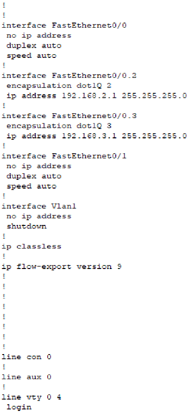
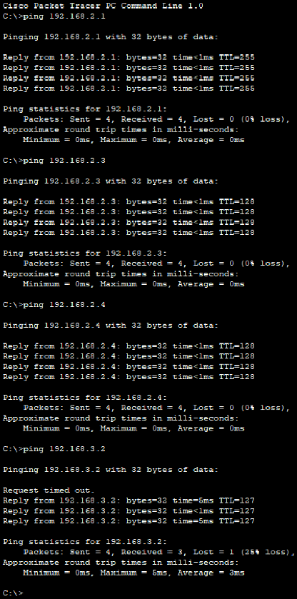
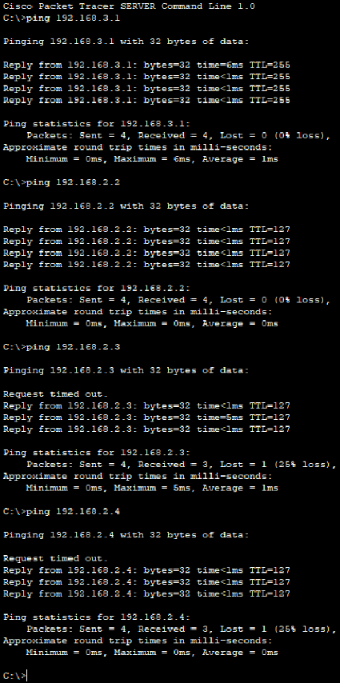
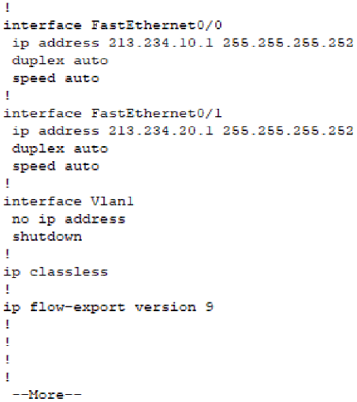
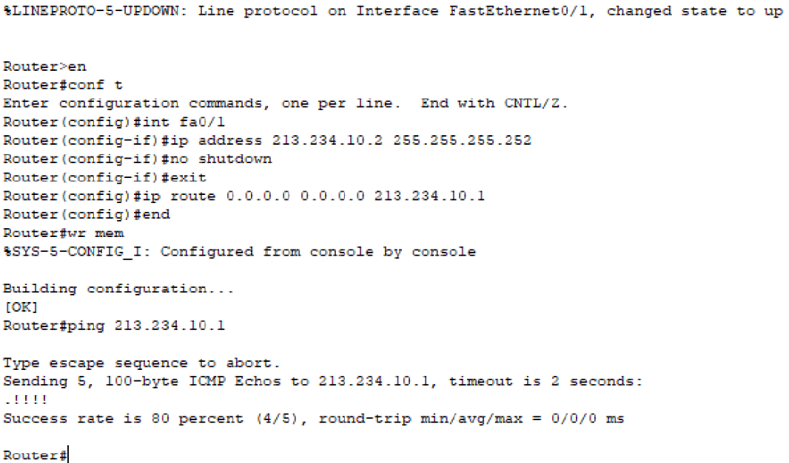
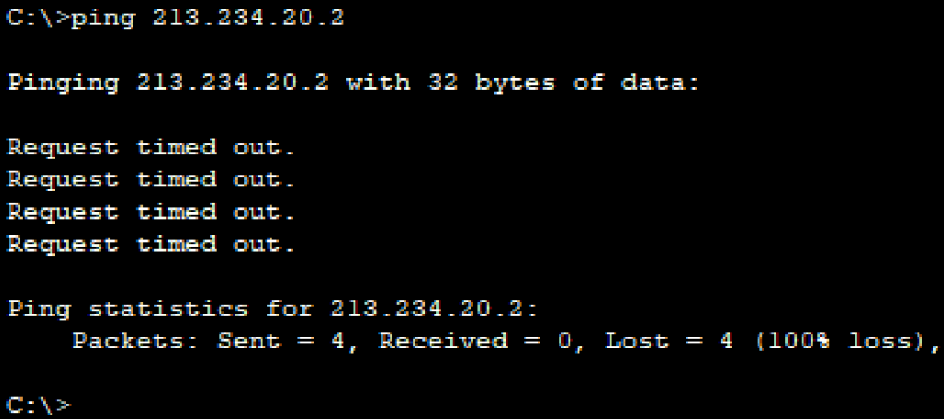
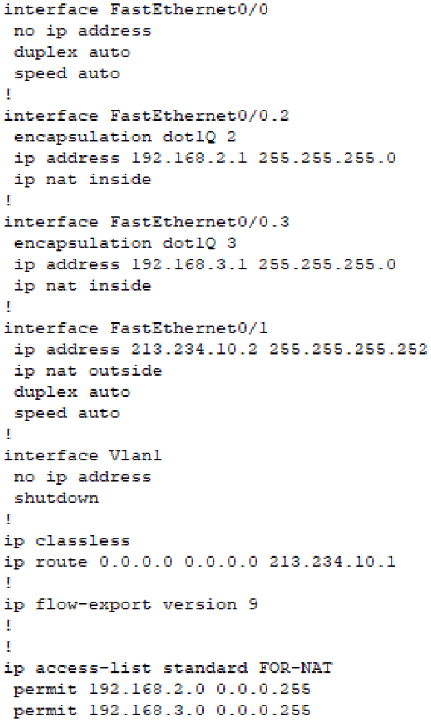
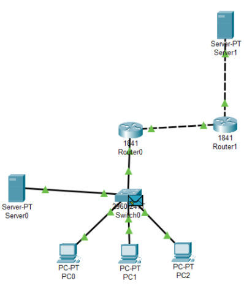

## Настройка интерфейсов VLAN:

## Проверка связи внутри VLAN:

## Связь сервера с компьютером и шлюзом:

## Настройка интерфейсов провайдера:

## Настройка внешнего интерфейса и шлюза:

## Связь до настройки NAT:

## Конфигурация NAT и ACL:

## Схема сети в Cisco:

